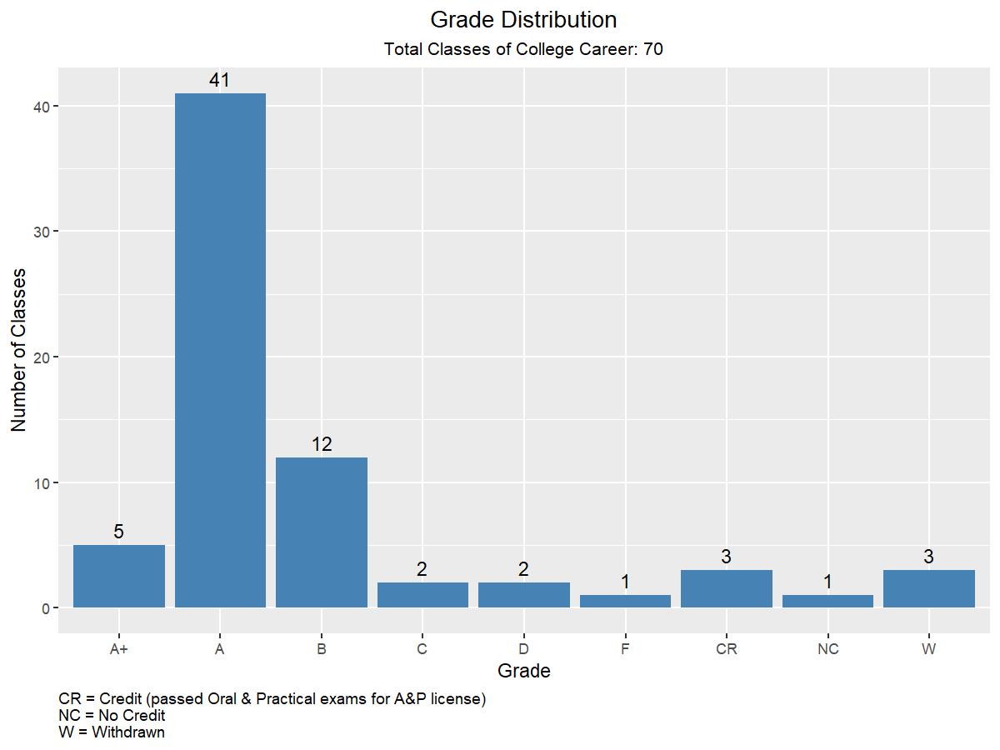
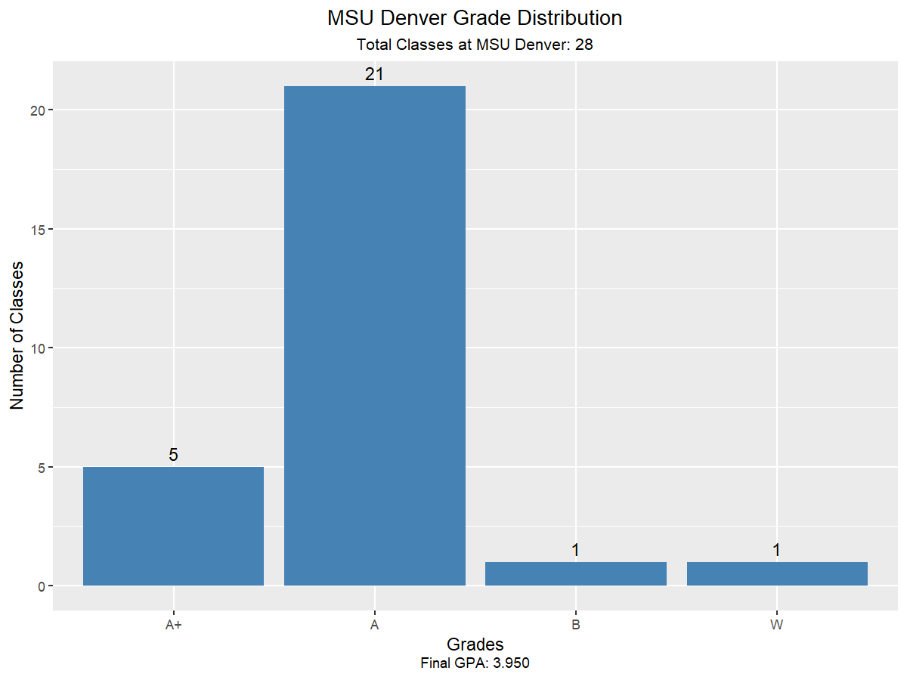
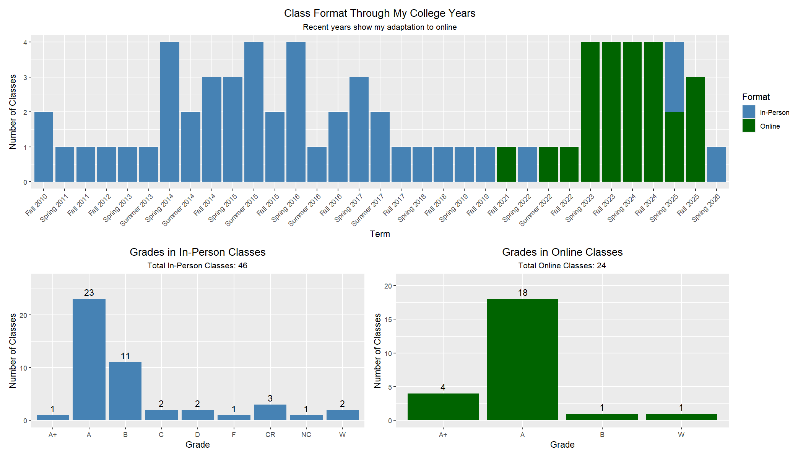
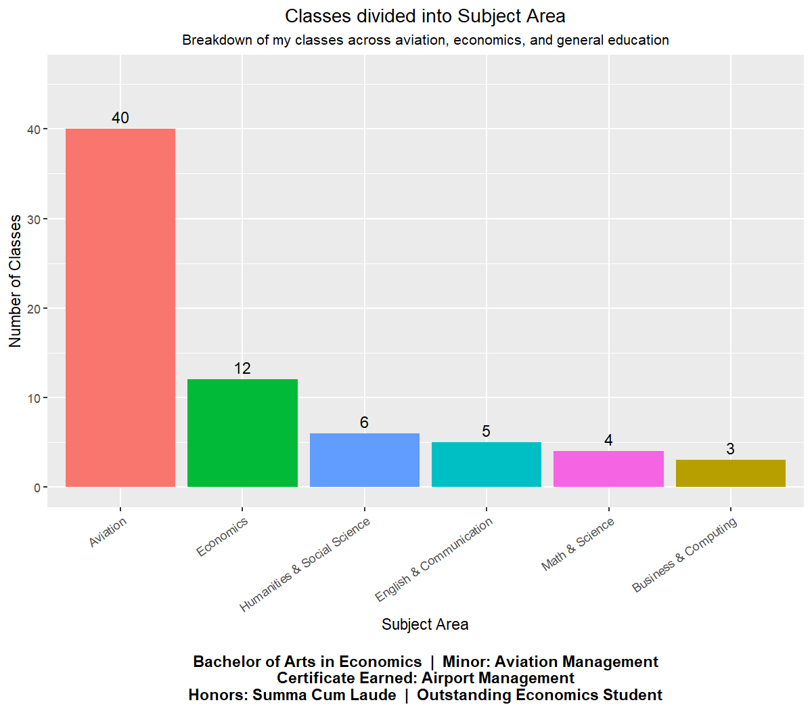
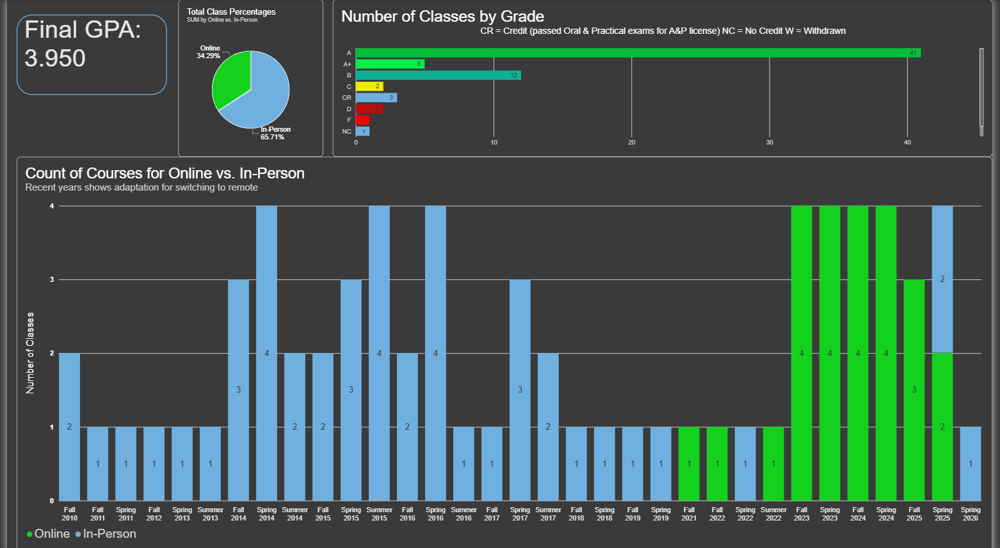
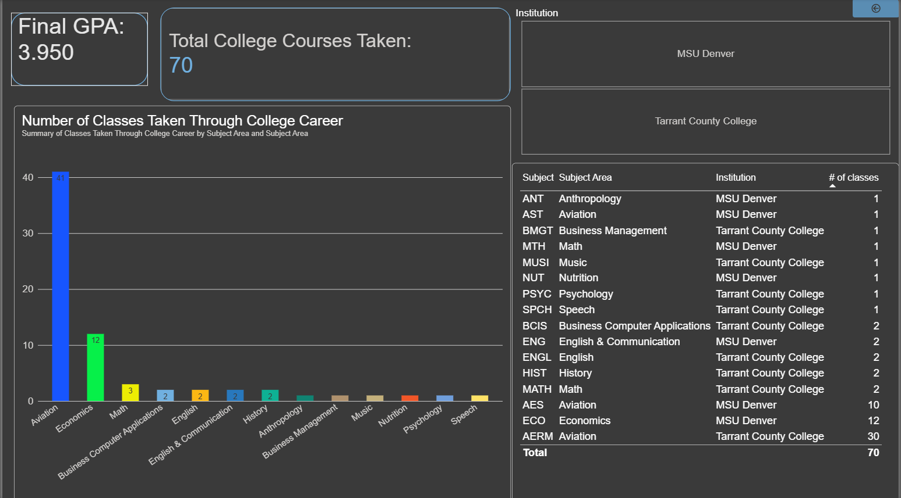

# college-transcript-analysis
This is my personal data analysis project, which I decided to do before my graduation. I analyzed my academic transcripts from the two institutions I attended, first in **R**, then in **Power BI**. I built this for a couple of reasons. 1: I wanted to practice my data visualization skills I learned in college, to try to remember as much as I could. 2. This is proof to myself that I can transition from aviation maintenance into a rewarding role in a different industry.

Part 1: R. Exploratory analysis and static visualizations using ggplot2, dplyr, patchwork, and ggtext.

Part 2: Power BI. An interactive dashboard built from the same combined transcript data, with KPI cards, filters by institution, and a breakdown of classes by subject area and if the class was in-person or online.

---

## About Me

I've been an aviation maintenance technician (A&P licensed) working on PT6 engines (hot section inspections, engine removals/reinstallations, and borescope work), along with 5 years for the Airframe side (Beechcraft King Airs, Pilatus PC-12/PC-24, Learjet 45s, etc.). I'm currently completing a **Bachelor of Arts in Economics** with a **minor in Aviation Management** and an **Airport Management Certificate** from Metropolitan State University of Denver.

**Honors:** Summa Cum Laude & Outstanding Economics Student for 2026

---

## My Project

I combined the transcript data from both colleges I attended (Tarrant County College and MSU Denver) into Excel, and then into a single CSV. After that, I used R to explore the data and build some charts. Each chart answers a specific question of my own making.

### R Chart 1: Overall Grade Distribution
First, I decided to do a grade distribution for every class I've taken across both schools. I included explanations for the posted non-traditional grades.

### R Chart 2: MSU Denver Grade Distribution
Second, I decided to display my grades earned at MSU Denver specifically, showing my final to be a 3.950 GPA (very proud of that).

### R Chart 3: Online vs In-Person Classes
Third, this has a timeline of how my classes shifted to online over the past several years, and the grades I earned in each format. I did this because I was curious, but I also felt that this displays that I can do well for a company with a remote position. (This one took the longest.)

### R Chart 4: Coursework by Subject Area
Finally, I created a breakdown of my classes across aviation, economics, and general education.

### Power BI Dashboard 1
To continue this project, I added the same data into Power BI and created dashboards for what was interesting about my college transcripts to me. 

### Power BI Dashboard 2

---

## Tools Used

- **R** — data analysis
- **ggplot2** — visualizations
- **dplyr** — data wrangling
- **patchwork** — multi-panel layouts
- **ggtext** — formatted chart text
- **Power BI** — interactive dashboard

---

## Files

- `csv_Combined_Transcripts.csv` — combined transcript data
- `R.Transcript_Data_for_College_Career.R` — full R analysis script
- `chart1` through `chart4` PNG files — the visualizations
- `Combined_College_Transcripts.pbix` — Power BI dashboard (open in Power BI Desktop to view)
